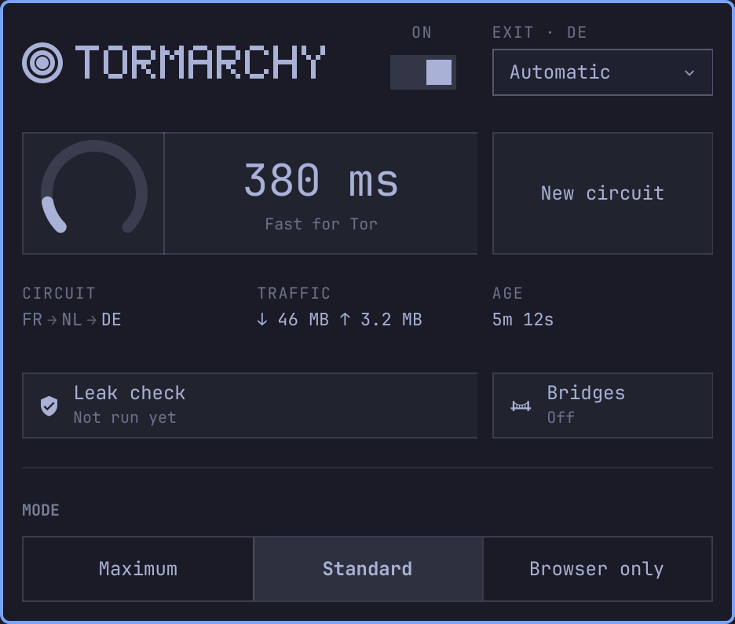
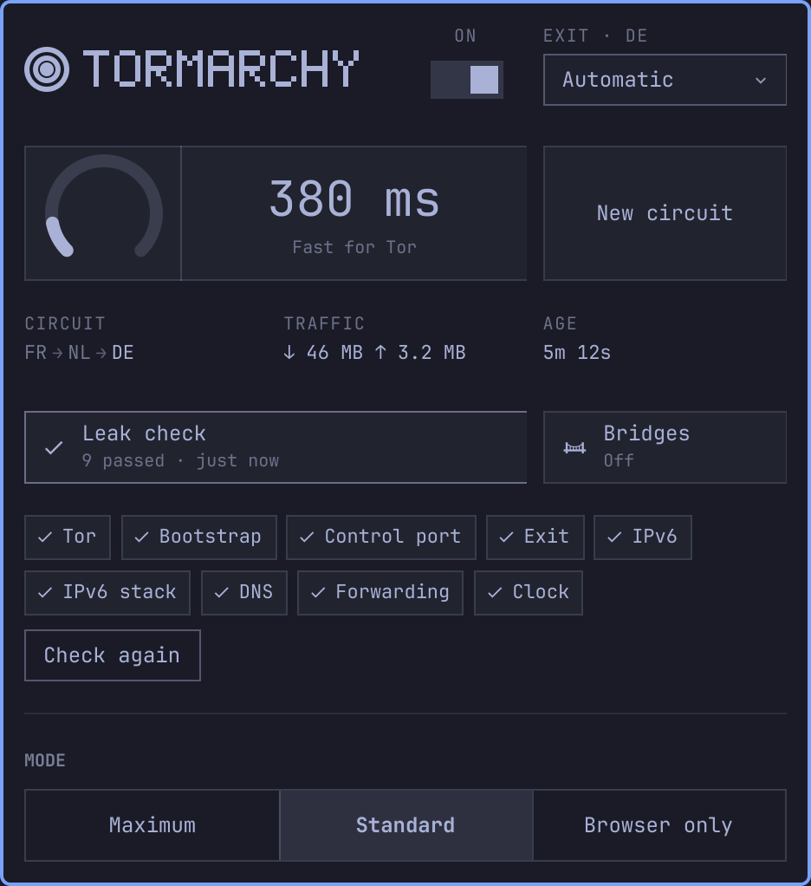
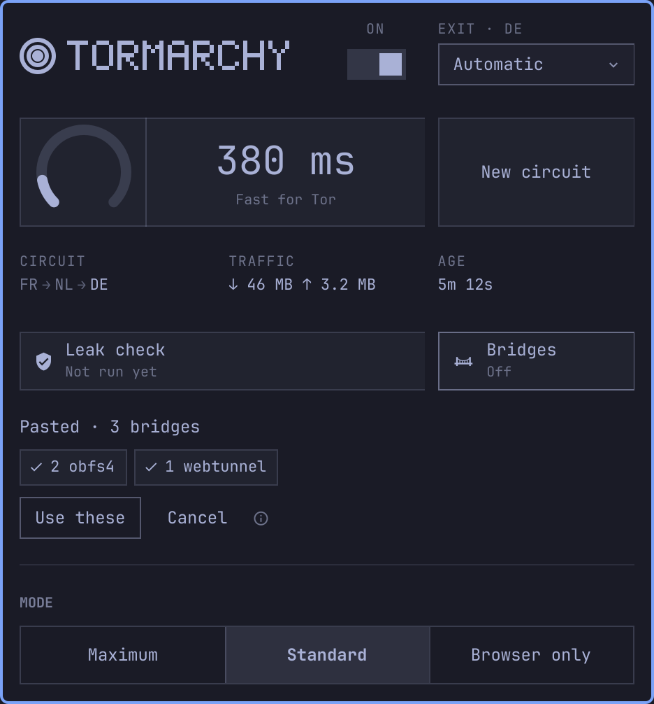

<p align="center">
  
</p>

<p align="center">
  A Tor toggle for the Omarchy bar. Click the onion, all your traffic goes
  through Tor. Click it again, it doesn't.
</p>

---

Needs Omarchy 4.x. Everything else it uses is already on an Arch box —
`nftables`, `systemd`, `polkit`, `curl`, `iproute2`. `setup` installs `tor`
itself. Bridges additionally want `obfs4proxy` (AUR) or `meek`, and it'll tell
you which if you need them.

## Install

```bash
omarchy plugin add https://github.com/TripleU613/tormarchy.git --enable
sudo ~/.config/omarchy/plugins/tripleu.tor/tormarchy setup
```

`setup` needs a terminal and tells you everything it touches as it goes. For the
record, that's: `tor` installed, `tormarchy` copied to `/usr/local/bin`, a config
snippet in `/etc/tor/torrc.d/`, one line added to `/etc/tor/torrc`, a polkit rule
so the toggle doesn't ask for a password, your user added to the `tor` group,
`/var/lib/tor` loosened to `0750` so it can read Tor's control cookie, and Tor
added to the Omarchy menu. It doesn't touch your Firefox or browser profiles —
browser mode makes its own.

The polkit rule covers only the commands that change routing — connect,
disconnect, mode, exit, bridge, panic and the browser lock — each pinned by name.
Anything else asks for your password, and nothing it covers runs a program you
name.

Run `setup` again after updating the plugin: the helper it installs is a copy,
and only `setup` refreshes it. The panel shows **Update helper** when it's due.

## Removing it

```bash
sudo ~/.config/omarchy/plugins/tripleu.tor/tormarchy uninstall
omarchy plugin remove tripleu.tor
```

`uninstall` puts all of the above back, including `/var/lib/tor` and the menu,
and takes the firewall rules down first so you can't end up without a network. Add `--purge` to
also drop the `tor` package and your group membership.

## Modes

| | |
|---|---|
| **Maximum** | Everything through Tor. Local network dropped too. |
| **Standard** | Everything through Tor, but printers, SSH and Syncthing still work. |
| **Browser only** | Nothing system-wide. Launches a browser that can't reach anything except Tor. |

Maximum and Standard also switch off IPv6 (loopback excepted, so things on `::1`
keep working) and refuse to forward traffic, so a VM or container can't route
around the rules. Disconnecting puts IPv6 back exactly as it was, interface by
interface.

Browser only doesn't just set a proxy preference — a proxy setting is a request
that WebRTC and QUIC happily ignore. `tormarchy browser` starts the browser in a
systemd scope of its own and, before the browser runs, adds a firewall rule for
that scope: loopback only, so the SOCKS proxy and nothing else. If the rule can't
go on, the browser doesn't start. Each launch is its own instance with its own
profile, so it never hands the window to a copy of the browser you already had
open. Firefox, Chromium-family browsers and qutebrowser are covered; anything
else gets the proxy variables and has to be closed first.

## What it costs

- **No UDP.** Video calls, WireGuard, most games.
- **No IPv6.**
- **No forwarding**, so VMs and containers lose their network.
- **No other VPN** at the same time.
- **No NTP**, so a very long session can drift its clock until Tor gives up.

Browser only avoids all of that.

And the obvious one: Tor changes where your traffic comes from, not who a site
already knows you are. If you were logged in before you connected, you're still
logged in.

## Panel

<p align="center">
  
</p>

Left click opens it, right click toggles, middle click gets a new circuit. Hover
it for the status in words.

Inside: `j`/`k` to move, `t` toggle, `n` new circuit, `e` exit country,
`s` measure latency, `d` leak check, `b` bridges, `r` refresh, `esc` to close.
Hover a hop in the circuit for the relay behind it — name, speed, and what the
network trusts it with.

The onion in the bar says where you are:

<p align="center">
  
</p>

| | |
|---|---|
| Rings and core lit | Everything is going through Tor. |
| Core pulsing | Connecting. Nothing moves until Tor has bootstrapped and a real request has made it through, so switching on is a blip, not a drop. |
| Core lit, rings dim | Browser only, with Tor up. The rest of the machine isn't routed. |
| Rings only, dim | Off. |
| Red | Tor stopped while you were connected, so the kill switch is holding the network shut. Turn it off to get it back. |

The switch can be turned off while it's still connecting, which cancels the
connection.

### Leak check

<p align="center">
  
</p>

The panel's answer to "is this actually working?". It asks check.torproject.org
whether you're coming from Tor, tries to reach an IPv6 host directly (which
should fail), and checks DNS, forwarding and your clock — the same checks as
`tormarchy doctor`, listed one per line. In browser-only it checks the proxy
itself.

It only runs when you ask. Each run is real requests to real hosts, and a tool
that phones out on a timer is a traffic pattern of its own. Changing anything —
connecting, switching mode — clears the old result rather than leaving it
vouching for a setup that's gone.

### Bridges

<p align="center">
  
</p>

If the network you're on blocks Tor, bridges get you in. Get some from
[bridges.torproject.org](https://bridges.torproject.org/options) or
[@GetBridgesBot](https://t.me/GetBridgesBot) on Telegram, copy them, and hit
**Paste bridges**. You'll see what you pasted — how many, which transports, and
whether this machine can run them — before anything changes. **Use these**
switches Tor over.

The lines go to `tormarchy` over stdin and nowhere else: never on a command line
(where any process on the machine could read them), never in a file you point
it at. Once applied they live in a root-only file; the panel only ever sees the
count. If you've saved bridges, a connect that stalls retries through them on
its own.

### Notifications

When something's wrong and you might not be looking at the bar: the kill switch
engaging (critical, stays until it's dealt with), Tor coming back, a connect
that fails while the panel's closed. One toast, updated in place, never a pile.
They go through Omarchy's own notifications, so do-not-disturb applies.

Set `notifications` in the plugin's settings to `all` to also hear about
connects and the bridge fallback, or `off` for silence.

## Commands

| | |
|---|---|
| `tormarchy connect` / `disconnect` | On and off. `--dry-run` prints the firewall rules without applying them. |
| `tormarchy mode strict` | Switch mode. Stays on if it was on. |
| `tormarchy status` | What's happening. |
| `tormarchy ip` | Your circuit and exit, straight from Tor. Doesn't phone anyone to ask. |
| `tormarchy newnym` | New circuit. |
| `tormarchy exit de` | Leave from Germany. `--list` shows what's available, `auto` lets Tor pick. |
| `tormarchy exit --exclude us,ru` | Never leave from these. Tor still picks from everywhere else, which keeps far more of the network than pinning one. `none` clears it. |
| `tormarchy bridge set < bridges.txt` | For networks that block Tor. `check` previews lines without changing anything, `on`/`off` switches saved ones. |
| `tormarchy browser` | Launch a browser the firewall locks to Tor. `--list` shows what it found. |
| `tormarchy doctor` | Check for leaks. `--json` for scripts. |
| `tormarchy boot enable` | Reconnect at boot if Tor was on when you shut down. Off by default. |
| `tormarchy menu add` | Tor in the Omarchy menu. `setup` does this; `menu remove` takes it out. |
| `tormarchy panic` | Rip out every rule. For when things go wrong. |

Tab completion for all of it, bash and zsh, installed by `setup`.

## Shortcuts

Keys are yours to pick, so these aren't added for you. A key for the panel and
one for the toggle, in `~/.config/hypr/bindings.lua`:

```lua
o.bind("SUPER + CTRL + SHIFT + T", "Tor", "omarchy-shell tripleu.tor toggle")
o.bind("SUPER + CTRL + SHIFT + O", "Toggle Tor", "omarchy-shell tripleu.tor toggleTor")
```

Plain commands on purpose, since they work on every Omarchy 4. The `{ panel = … }`
shorthand is newer than the 4.0 releases, and `{ ipc = "..." }` splits its
target at the first dot, which `tripleu.tor` has.

## In the Omarchy menu

`setup` adds **Trigger › Toggle › Tor**, ticked while you're connected, and a
**Trigger › Tor** submenu: connect or disconnect, new circuit, the panel, the leak
check and bridges. Omarchy gives plugins no menu of their own, so these live in
your `~/.config/omarchy/extensions/omarchy-menu.jsonc`, between two marker
comments. Nothing else in that file is touched, a symlinked one stays a symlink,
and `tormarchy menu remove` takes them back out.

## If it breaks

If Tor dies while you're connected, the rules stay and your network goes with
them. That's on purpose — a kill switch that fails open isn't one. Toggle it off,
or run `tormarchy panic`.

Nothing survives a reboot, so restarting always gets your network back.

That's also why `tormarchy boot enable` is opt-in rather than the default —
turning it on trades a little of that guarantee for not having to reconnect
after every restart. It only reconnects if Tor was on when you shut down, comes
back in the mode you were using, and if the network isn't there or Tor can't
bootstrap it applies no rules at all.

## License

MIT

Not affiliated with or endorsed by the Tor Project.
