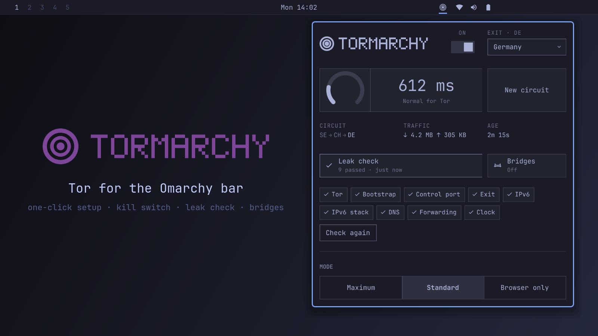
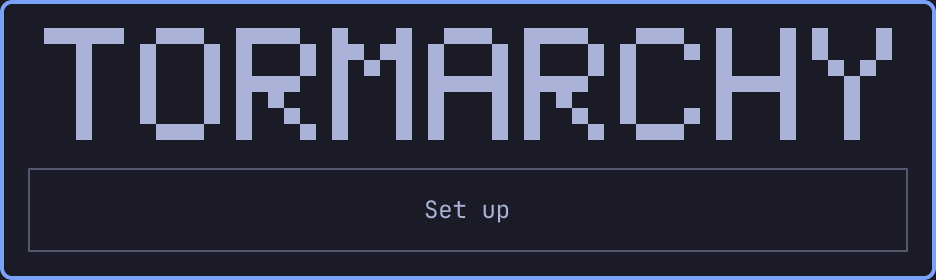
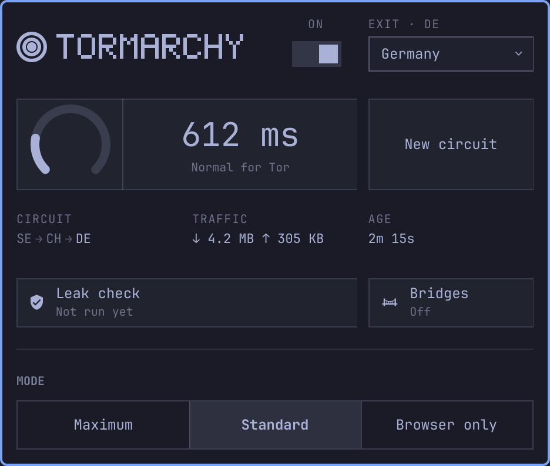
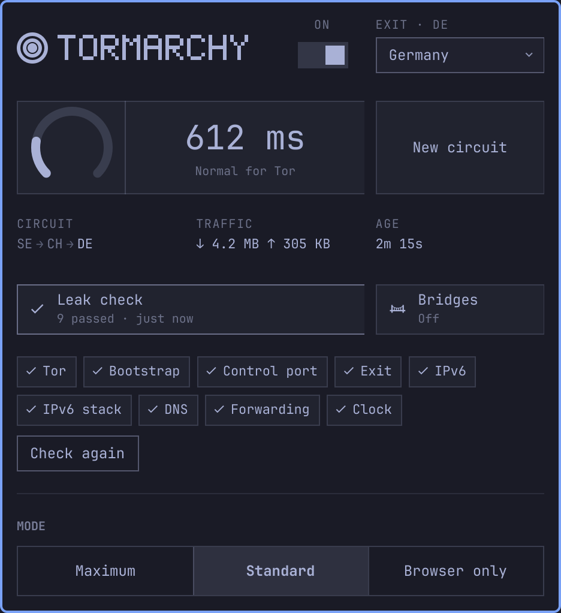
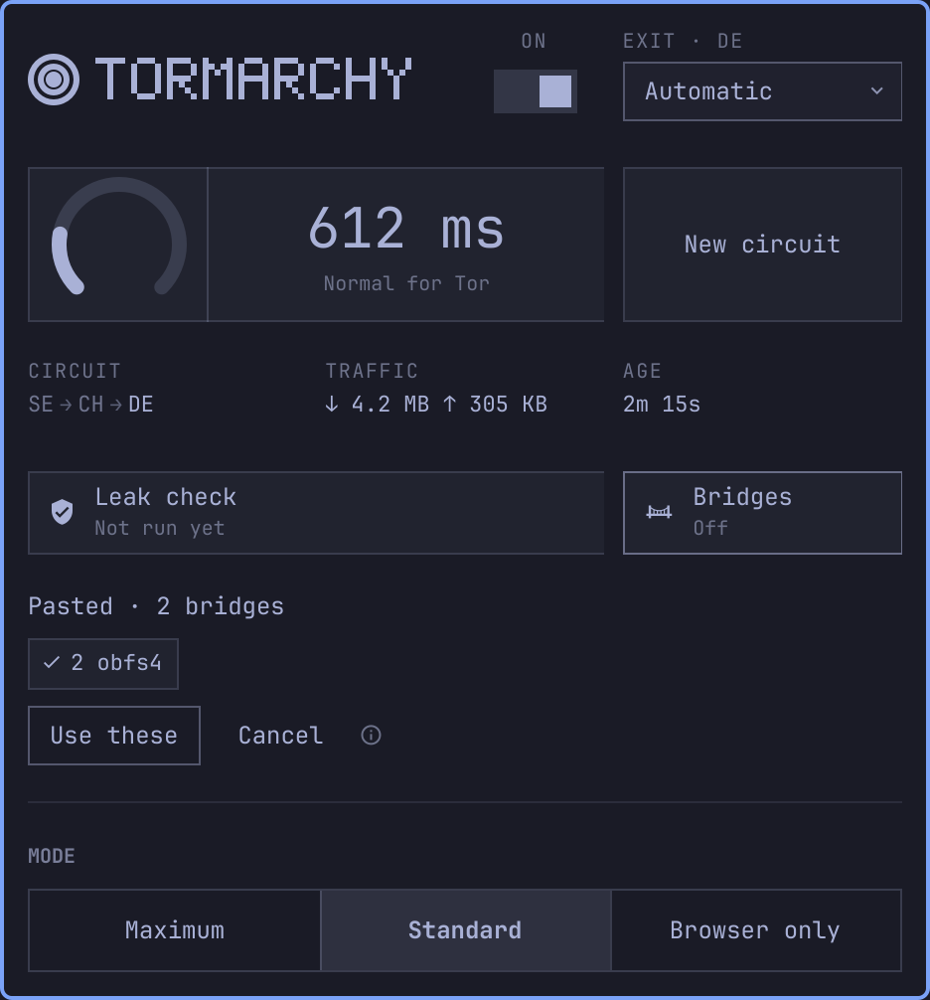

<p align="center">
  
</p>

<p align="center">
  Click the onion and all your traffic goes through Tor. Click it again, it doesn't.
</p>

## Install

```bash
omarchy plugin add https://github.com/TripleU613/tormarchy.git --enable
```

Then click the onion in the bar and press **Set up**. Omarchy asks for your
password once, and a notification tells you when it's ready. That's it — the
switch never asks again.

<p align="center">
  
</p>

Needs Omarchy 4 on x86_64. Setup installs `tor` for you.

## What you get

- **A real kill switch.** If Tor stops while you're connected, your network
  stops too instead of quietly leaking.
- **Three modes.** Everything through Tor, everything but your local network,
  or just one locked-down browser.
- **Pick your exit country**, or rule some out.
- **New circuit** in one click — open tabs move to it too, not just new ones.
- **A leak check** you run when you want proof it's working.
- **Bridges** for networks that block Tor: copy, paste, done.
- **Notifications** only when something needs you, through Omarchy's own.

<table>
  <tr>
    <td align="center"><br><sub>Connected</sub></td>
    <td align="center"><br><sub>Leak check</sub></td>
    <td align="center"><br><sub>Bridges</sub></td>
  </tr>
</table>

## Modes

| | |
|---|---|
| **Maximum** | Everything through Tor. Local network blocked too. |
| **Standard** | Everything through Tor, but printers, SSH and Syncthing on your LAN still work. |
| **Browser only** | Nothing system-wide. Opens a browser that can reach nothing but Tor. |

On a network you don't trust, use Maximum: Standard reaches your local network
directly.

## The icon

<p align="center">
  
</p>

On · connecting · browser only · off · **red** means Tor stopped and the kill
switch is holding your network shut — toggle off to get it back.

Left click opens the panel, right click toggles, middle click is a new circuit.

## Good to know

While connected there's **no UDP** (video calls, WireGuard, most games), **no
IPv6**, **no VMs or containers online**, and **no other VPN**. Browser only
avoids all of that.

Tor changes where your traffic comes from, not who you are. If you were logged
in somewhere before connecting, you still are.

**If it ever gets stuck,** toggle it off, or run `tormarchy panic`. A reboot
always brings your network back — nothing survives it unless you turn on
`tormarchy boot enable`.

## Remove it

Run `sudo tormarchy uninstall`, then `omarchy plugin remove tripleu.tor`.
Everything is put back, and the firewall rules come down first so you're never
left offline. Add `--purge` to also drop the `tor` package and your membership
of the `tor` group, which a plain uninstall leaves in place.

---

<details>
<summary><b>Keyboard and commands</b></summary>

In the panel: `j`/`k` move, `t` toggle, `n` new circuit, `e` exit country,
`s` latency, `d` leak check, `b` bridges, `r` refresh, `esc` close.

| | |
|---|---|
| `tormarchy connect` / `disconnect` | On and off. `--dry-run` prints the firewall rules without applying them. |
| `tormarchy mode strict` | Switch mode, live if connected. |
| `tormarchy status` | What's happening. |
| `tormarchy ip` | Your circuit and exit, straight from Tor. |
| `tormarchy newnym` | New circuit. |
| `tormarchy exit de` | Leave from Germany. `--list` shows what's available, `auto` lets Tor pick. |
| `tormarchy exit --exclude us,ru` | Never leave from these. `none` clears it. |
| `tormarchy bridge set < bridges.txt` | Bridges from a file. `check` previews, `on`/`off` switches saved ones. |
| `tormarchy browser` | A browser the firewall locks to Tor. `--list` shows what it found. |
| `tormarchy doctor` | Leak check. `--json` for scripts. |
| `tormarchy boot enable` | Reconnect at boot if Tor was on at shutdown. Off by default. |
| `tormarchy menu add` / `remove` | Tor in the Omarchy menu (setup adds it). |
| `tormarchy panic` | Remove every rule and stop Tor. |

Bash and zsh completion come with setup.

</details>

<details>
<summary><b>Shortcuts and the Omarchy menu</b></summary>

Keys are yours to pick. For example, in `~/.config/hypr/bindings.lua`:

```lua
o.bind("SUPER + CTRL + SHIFT + T", "Tor", "omarchy-shell tripleu.tor toggle")
o.bind("SUPER + CTRL + SHIFT + O", "Toggle Tor", "omarchy-shell tripleu.tor toggleTor")
```

Setup adds **Trigger › Toggle › Tor** (ticked while connected) and a
**Trigger › Tor** submenu to `~/.config/omarchy/extensions/omarchy-menu.jsonc`,
between two marker comments. Nothing else in that file is touched.

</details>

<details>
<summary><b>Leak check, bridges and notifications in detail</b></summary>

**Leak check** asks check.torproject.org whether you're on Tor, tries to reach
an IPv6 host directly (which should fail), and checks DNS, forwarding and your
clock — the same as `tormarchy doctor`. It only runs when you ask: a tool that
phones out on a timer is a traffic pattern of its own.

**Bridges:** get some from [bridges.torproject.org](https://bridges.torproject.org/options)
or [@GetBridgesBot](https://t.me/GetBridgesBot), copy them, press **Paste
bridges**. You see how many, which transports, and whether this machine can run
them before anything changes. They travel over stdin only, never a command line,
and are stored root-only. Some transports want `obfs4proxy` (AUR) or `meek`;
the panel says which.

**Notifications:** the kill switch engaging, Tor coming back, a connect that
fails while the panel is closed. One toast, updated in place. Set
`notifications` to `all` for more, or `off` for none.

</details>

<details>
<summary><b>Security: what setup installs, and why you can trust it</b></summary>

Setup downloads the release for your plugin version and checks its
[Sigstore](https://www.sigstore.dev/) signature before anything runs as root: it
must have been built by this repository's own release workflow, on `master`, at
the exact commit the version's tag names on GitHub. There's no signing key to
steal. If it doesn't verify, nothing is installed.

The password dialog uses polkit's own wording — it asks to run
`~/.config/omarchy/plugins/tripleu.tor/setup` as the super user. That's
polkit's always-ask rule, the same check `sudo` makes. Prefer a terminal?
`sudo ~/.config/omarchy/plugins/tripleu.tor/setup` does the same.

It installs: `tor`, `tormarchy` and `tormarchyd` in `/usr/local/bin`, a snippet
in `/etc/tor/torrc.d/` plus one include line in `/etc/tor/torrc`, a polkit rule
so the switch doesn't ask for a password, your user in the `tor` group,
`/var/lib/tor` at `0750` so the control cookie is readable, completion, and the
menu entries. Every file comes from inside the verified binary. Your browser
profiles are never touched.

The polkit rule covers only connect, disconnect, mode, exit, bridge, panic and
the browser lock, each pinned by name. Nothing it covers runs a program you
name. Browser only isn't a proxy setting either: the browser runs in its own
systemd scope with a firewall rule allowing loopback only, so WebRTC and QUIC
can't slip past.

After a plugin update the panel shows **Update helper**, which runs setup again
the same way.

</details>

<details>
<summary><b>How it's built</b></summary>

Two small Rust programs and a little QML.

| | |
|---|---|
| `tormarchy` | The command line, and the only part that runs as root — briefly, through polkit or `sudo`. |
| `tormarchyd` | Runs as you. Holds one connection to Tor's control port and is told when something changes, instead of polling. Decides everything the panel shows. |
| The QML | Draws what `tormarchyd` says and sends back your clicks. |

</details>

## License

MIT. Not affiliated with or endorsed by the Tor Project.
